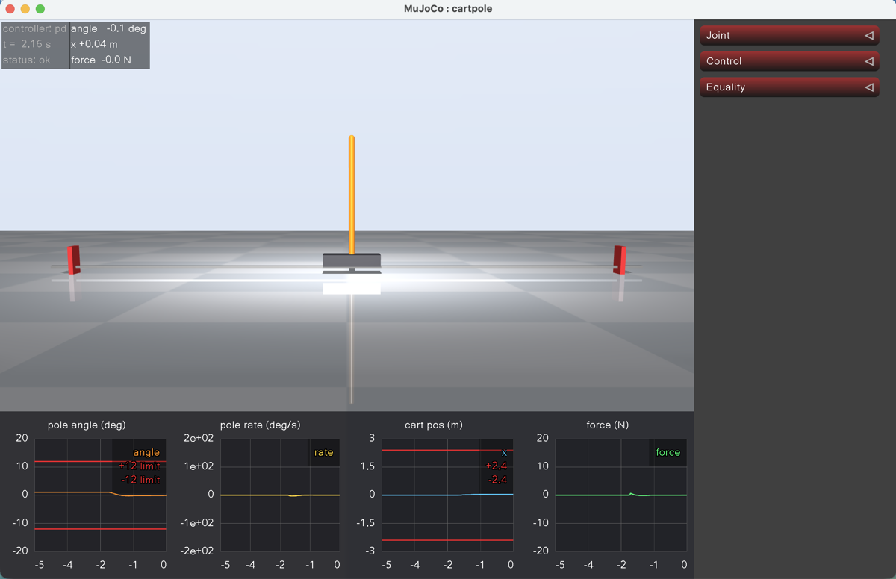
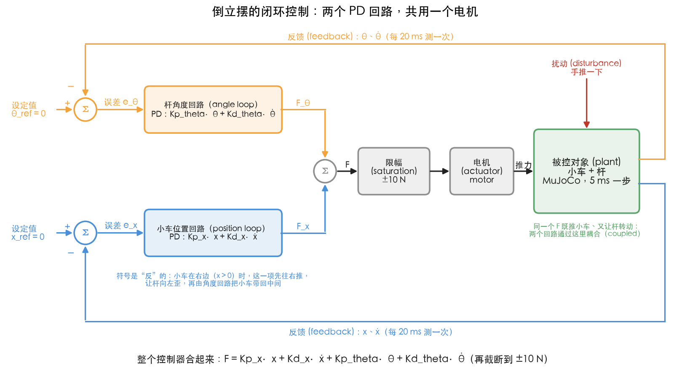
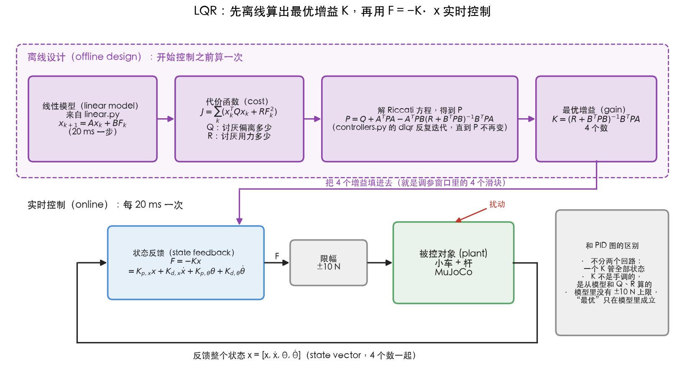

# rl-pendulum

用一个倒立摆（cart-pole）从零学控制：先在 MuJoCo 里自己搭仿真，再用传统控制（PID、LQR）把它稳住，然后一步步换成强化学习（reinforcement learning, RL）。每一课都在同一个仿真上做，可以直接比较各种方法的效果。



## 快速开始

需要 Python 3.12（课程环境用 [uv](https://github.com/astral-sh/uv) 创建）：

```bash
uv venv --python 3.12 .venv
uv pip install --python .venv/bin/python -r requirements.txt

.venv/bin/python test_sim.py              # 仿真自检，10 项都要 PASS
.venv/bin/python lesson1_build_sim.py     # 第 1 课：生成 out/ 下的视频和曲线

# 实时窗口（macOS 上要用 mjpython 启动）
.venv/bin/mjpython view.py                # 自己用 Control 面板的 push 滑块推
.venv/bin/mjpython view.py --ctrl pd      # 让 PD 控制器推
```

实时窗口里：空格暂停，Backspace 重置；双击杆后 Ctrl + 右键拖动，可以推它一下（扰动，disturbance）。

## 模型

| 部件 | 设置 |
|---|---|
| 小车（cart） | 1.0 kg，滑动关节（slide joint），±2.4 m 是失败线，±2.55 m 有物理挡块 |
| 杆（pole） | 0.1 kg，长 1.0 m，均匀细杆（惯量 m·L²/12）；铰链关节（hinge joint），角度为正 = 杆顶向右倒，限位 ±95° |
| 电机（actuator） | 水平推力，−10 ~ +10 N，每 20 ms 更新一次 |
| 物理 | 重力 9.8 m/s²，RK4 积分，步长 5 ms |
| 失败 | 杆倾斜超过 12°，或小车超过 ±2.4 m |

状态（state）4 个数：小车位置 x、小车速度 ẋ、杆角度 θ、杆角速度 θ̇。

## 仿真自检

`test_sim.py` 检查 10 项：参数、符号约定、和手写运动方程一致、能量守恒、水平动量守恒、推力截断、失败判断、物理限位、可重复、线性化模型。改了 `cartpole.xml` 或 `env.py` 以后都要先跑它。

顺带发现一件事：经典 CartPole（包括 gymnasium）每 20 ms 用一次欧拉积分，和精确解比，0.5 秒内杆角度最多差 5.6°。这里用 MuJoCo 的 RK4、每 5 ms 一步，和细步长的参考解只差 0.015°。

## 控制闭环



LQR 不手调增益，而是从线性模型和代价函数（Q、R）离线算出最优的 4 个增益：



`view.py --ctrl lqr --R 0.1` 用 LQR 算增益；`view.py --ctrl tune` 打开调参模式：Control 面板里 4 个滑块就是图里的 Kp_x、Kd_x、Kp_theta、Kd_theta，拖动后自动从起点重来。

## 课程

| 课 | 主题 | 状态 |
|---|---|---|
| 1 | 在 MuJoCo 里搭倒立摆，核对物理；开环（open loop）推法为什么一定会倒 | 完成 |
| 2 | 传统控制：手调 PID，再用 LQR 从模型算出最优参数；抗扰动测试 | 完成 |
| 2.5 | 模型预测控制（MPC）：把推力上限和失败线写进约束，和 LQR 比抗冲击能力 | 完成 |
| 3 | 最简单的“学习”：瞎猜和爬山找 4 个增益；奖励投机（reward hacking）和奖励塑形（reward shaping） | 完成 |
| 4 | Q-learning：价值函数（value function）、折扣、探索 | 计划中 |
| 5 | 策略梯度（policy gradient）：REINFORCE | 计划中 |
| 6 | Actor-Critic 和 PPO | 计划中 |
| 7 | 摆起（swing-up）：连续动作和奖励设计 | 计划中 |
| 8 | 域随机化（domain randomization）和 sim2real：噪声、延迟、参数误差 | 计划中 |
| 9 | 教师策略（teacher policy）和行为克隆（behavior cloning）：学生会继承教师的缺点 | 计划中 |

## 文件

| 文件 | 内容 |
|---|---|
| `cartpole.xml` | MuJoCo 模型（MJCF） |
| `env.py` | 环境：`reset()`、`step(推力)`、失败判断、`simulate()` |
| `linear.py` | 平衡点附近的线性模型，给 LQR 用 |
| `sim.py` | 手写运动方程版，只用来核对 MuJoCo |
| `viz.py` | 离屏渲染视频、画曲线 |
| `view.py` | 实时窗口，带曲线 |
| `test_sim.py` | 仿真自检 |
| `lesson*.py` | 各课脚本 |

## 许可证

MIT
